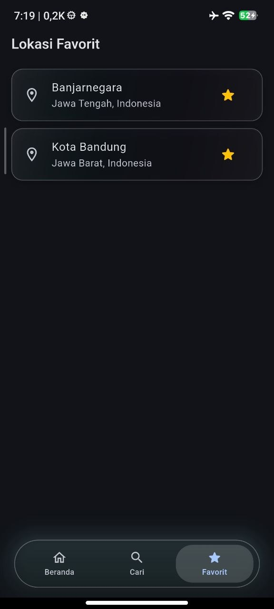

# Weather App - Responsi Flutter Pemrograman Mobile

## Identitas
- Nama: Muhammad Faqih Muhyiddin
- NIM: H1D024068
- Tugas: Responsi Flutter - Pemrograman Mobile

## Deskripsi
Aplikasi prakiraan cuaca berbasis Flutter menggunakan Open-Meteo API sebagai sumber data cuaca, Provider untuk state management, SharedPreferences untuk penyimpanan lokal, serta arsitektur MVVM.

## Fitur
- Cuaca terkini: suhu, kelembapan, kecepatan angin, curah hujan, dan kondisi cuaca.
- Prakiraan harian hingga 5 hari ke depan dengan suhu max/min dan peluang hujan.
- Pencarian kota via Open-Meteo Geocoding API.
- Lokasi favorit tersimpan di SharedPreferences.
- Tema gelap dan terang dengan tombol switch.
- Desain modern dengan efek blur dan edge-to-edge layout.

## Teknologi
Flutter, Dart, HTTP, Provider, SharedPreferences, Open-Meteo API, dan Material 3.

## Menjalankan Project
```bash
flutter pub get
flutter analyze
flutter test
flutter run
```

## Struktur MVVM
Model data cuaca dan lokasi berada di `lib/models`, akses API dan penyimpanan lokal di `lib/services`, logika state di `lib/viewmodels`, UI di `lib/views`, tema di `lib/theme`, serta widget reusable di `lib/widgets`.

```text
lib/
├── main.dart
├── models/
│   ├── location_model.dart
│   └── weather_model.dart
├── services/
│   ├── geocoding_service.dart
│   ├── storage_service.dart
│   └── weather_service.dart
├── theme/
│   └── app_theme.dart
├── viewmodels/
│   ├── location_viewmodel.dart
│   ├── theme_viewmodel.dart
│   └── weather_viewmodel.dart
├── views/
│   ├── favorites_screen.dart
│   ├── home_screen.dart
│   ├── main_shell.dart
│   └── search_screen.dart
└── widgets/
    └── liquid_glass_card.dart
```

## Repository
Repository ini dibuat untuk pengumpulan Responsi Flutter Pemrograman Mobile.

## Video Demo
*(tambahkan link video di sini)*

## Screenshot Aplikasi

<table>
  <tr>
    <td align="center"><strong>Beranda (Terang)</strong><br></td>
    <td align="center"><strong>Beranda (Gelap)</strong><br></td>
    <td align="center"><strong>Cari Lokasi</strong><br></td>
  </tr>
  <tr>
    <td align="center"><strong>Hasil Pencarian</strong><br></td>
    <td align="center"><strong>Lokasi Favorit</strong><br></td>
    <td align="center"><strong>Detail Cuaca</strong><br></td>
  </tr>
</table>

## Checklist Pengujian
- [x] Data cuaca terkini dari Open-Meteo API.
- [x] Prakiraan harian hingga 5 hari.
- [x] Pencarian kota via Geocoding API.
- [x] Simpan dan muat lokasi favorit dari SharedPreferences.
- [x] Switch tema gelap dan terang.
- [x] `flutter analyze` tanpa issue.
- [x] `flutter test` lulus.
- [ ] Screenshot aplikasi setelah pengujian manual.
- [ ] Link video penjelasan kode.
